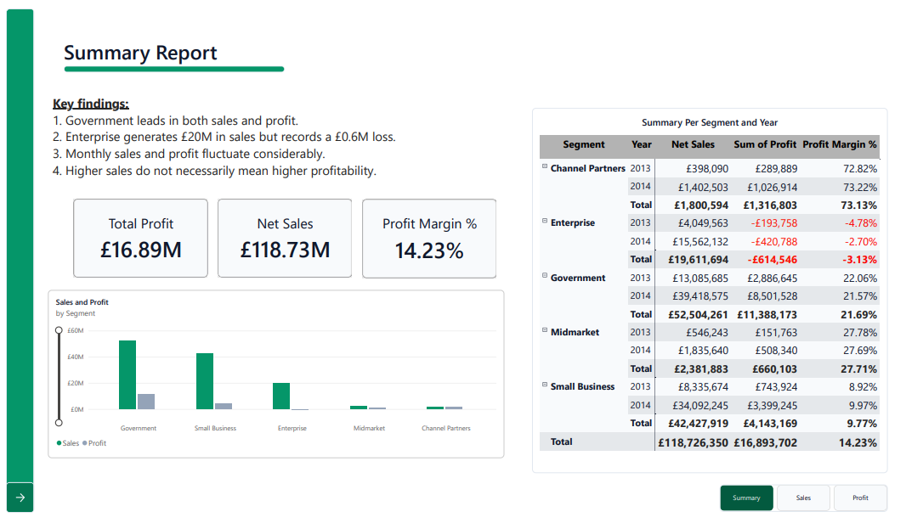

# Improving User Experience in Power BI | DIO Lab

### From a financial report to a more user-friendly executive dashboard

Another challenge completed as part of my **DIO Power BI Bootcamp**! 😊

This time, the challenge wasn't about creating a report from scratch. It was about going back to a report I had already built and asking myself:

**How can I make this easier to navigate, understand and use?**

The DIO lab focused on improving the user experience (UX) through positioning, contrast, proportions, data segmentation and navigation.

We were encouraged to adapt the design and make our own decisions, rather than simply follow a fixed layout.

And that's exactly what I did!

## My updated report

<p align="center">
  
</p>

*My redesigned Power BI report, featuring improved navigation, a cleaner layout and a new executive Summary page.*

The report uses Microsoft's **Financial Sample** dataset and contains three pages:

- **Summary:** An executive overview of financial performance.
- **Sales:** A closer look at sales performance across segments, countries and time.
- **Profit:** A more detailed view of profitability.

## Starting with the original report

My original report already contained useful information, including sales, discounts, profit, units sold and comparisons across countries and business segments.

But looking at it again, I realised there was room for improvement.

Some decorative elements were taking up space without adding much value, and the report didn't have a dedicated page where someone could quickly understand the overall business performance.

So I started by simplifying the layout.

I removed unnecessary shapes, reduced visual clutter and worked on making the positioning and spacing more consistent.

I also wanted to make the report feel like one connected experience, rather than a collection of separate pages.

## Creating an Executive Summary

This was the biggest change I made!

I added a completely new **Summary** page, designed for someone who wants to understand the main findings without having to investigate every chart.

I decided to include three KPI cards:

- **Net Sales:** £118.73M
- **Total Profit:** £16.89M
- **Profit Margin:** 14.23%

I also added a chart comparing sales and profit by segment, alongside a matrix showing financial performance by segment and year.

And rather than leaving users to interpret everything themselves, I included a short section highlighting the key findings.

One particularly interesting result was that the **Enterprise segment generated approximately £20M in sales but recorded a £0.6M loss**.

That really illustrates why looking at sales figures alone doesn't tell the whole story!

## Learning more DAX

To create the Summary page, I needed some additional calculations.

I created measures for Net Sales and Total Profit, followed by a Profit Margin percentage.

```dax
Net Sales =
SUM(financials[Sales])
```

```dax
Total Profit =
SUM(financials[Profit])
```

```dax
Profit Margin % =
DIVIDE(
    [Total Profit],
    [Net Sales],
    0
)
```

I initially considered including year-on-year sales growth, but after reviewing the dataset, I decided against it.

The data covers September 2013 to December 2014, so there isn't a complete previous year available for comparison.

Rather than include a KPI that could give a misleading impression, I chose to leave it out.

Another reminder that **just because we can calculate something doesn't necessarily mean we should display it!**

## Improving the matrix

I wanted the Summary matrix to show more than just financial totals.

I added a date hierarchy so users could explore performance by year, and applied conditional formatting to make negative profit and profit margin values stand out.

This was particularly useful for highlighting the Enterprise segment.

I also spent some time adjusting the formatting to make the matrix easier to read without overwhelming the Summary page.

And yes, I spent longer than expected trying to remove a little filter indicator I'd accidentally enabled! 😂

It turned out to be an action button setting under the General formatting options.

Another little Power BI lesson learned!

## Improving navigation and consistency

I wanted users to be able to move between the Summary, Sales and Profit pages without having to rely on Power BI's page tabs.

So I added consistent navigation buttons, with the current page highlighted.

I also worked on:

- Keeping page titles and visual elements consistently positioned.
- Using a restrained colour palette.
- Improving the spacing between charts and KPI cards.
- Making the Sales and Profit pages visually consistent.
- Removing decorative elements that didn't contribute to the report.
- Keeping the information organised around what users would actually want to investigate.

The goal was to make the report easier to use, not simply make it look prettier.

## Testing the updated report

Once the changes were complete, I reviewed the three pages and checked that the key figures remained consistent.

The final report includes:

- An executive Summary page with KPIs, key findings and a financial matrix.
- A Sales page showing performance by segment, country and time.
- A Profit page showing profitability across the same business dimensions.
- Navigation buttons for moving between pages.
- Date filtering and drill-down functionality.
- Conditional formatting to highlight negative results.

I also exported the report as a PDF so the finished design can be viewed without opening Power BI.

## What I would improve next time

Although I'm happy with the progress, there are still things I'd like to explore in future projects.

**1. Dynamic key findings**

The Summary page currently contains written observations based on the full dataset.

In a future version, I'd like to explore making these findings dynamic, so they respond to filters and reflect the data currently being viewed.

**2. A more compact executive matrix**

The matrix contains useful detail, but I could make it easier to scan by initially showing segment totals and allowing users to expand the year hierarchy when needed.

**3. More testing of user interactions**

I'd like to spend more time testing how slicers, navigation and charts behave together, including whether filters remain consistent across pages.

**4. Report performance**

I removed unnecessary visual elements to simplify the report, but I'd also like to learn how to use Power BI's Performance Analyzer to measure whether design changes actually improve performance.

## What I learned

This project gave me more practice with:

- Power BI report design and visual hierarchy
- User experience principles
- Executive dashboard design
- DAX measures
- KPI cards
- Matrices and conditional formatting
- Date hierarchies
- Navigation buttons and visual formatting
- Report validation and troubleshooting

But my biggest takeaway was that **a report can contain perfectly good data and still be difficult to use**.

Creating the visuals is only part of the job. Thinking about who will use the report, what information they need first and how easily they can find it is just as important.

I really enjoyed revisiting something I'd already created and seeing how much I could improve it with what I've learned since.

And there is still plenty more to learn! 😊

---

## Project files

- `updating_report_for_UX_DIOlab.pbix` — The completed interactive Power BI report.
- `updating_report_for_UX_DIOlab.pdf` — PDF export showing all three report pages.
- `updating_report_for_UX_DIOlab.PNG` — Screenshot of the updated report.

*Created as part of the DIO Power BI Bootcamp, using Microsoft's Financial Sample dataset.*
